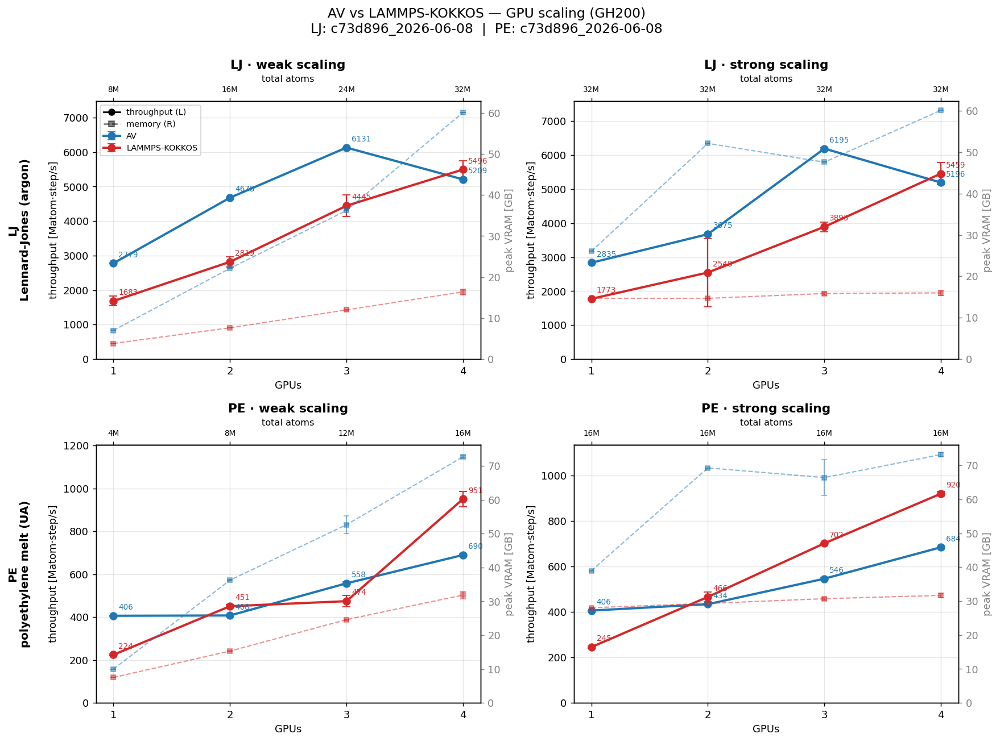
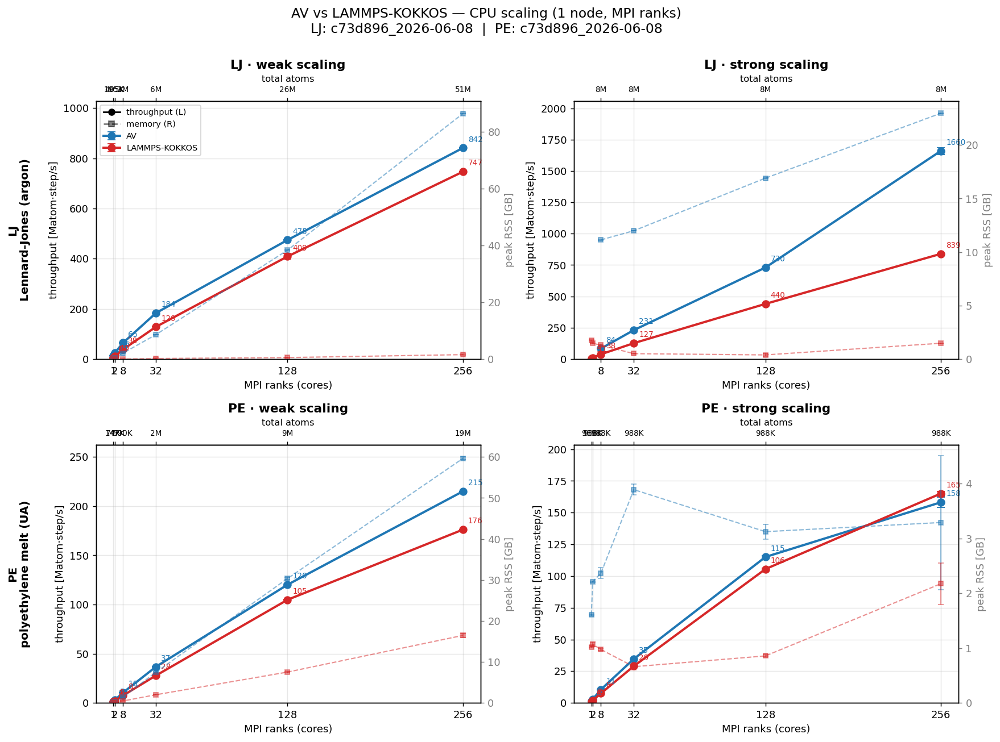

# Multi-GPU scaling benchmark — AV vs LAMMPS-KOKKOS

Permanent, auditable, comparable. **One** scan script + **one** plot script;
data is stored per system and keyed to the exact code that produced it. Never
copy these scripts into a dated folder — re-run them.

## Layout (organized by system, not by date)
```
benchmarks/md/
├── bench_scaling.sbatch     # the ONE scan (run per system)
├── plot_scaling.py          # the ONE plotter
├── lib_scaling.sh           # shared helpers (peak-VRAM, cbrt, LAMMPS loop-time parse)
├── lj/  in.lj_kk  config.sh  runs/<sha>_<date>/{results.csv, meta.json}
└── pe/  in.pe_kk  pe_base.data  gen_pe_chain_mol.py  config.sh  runs/<sha>_<date>/{...}
```
Committed: `results.csv` + `meta.json` per run (data only — an auditable history
of numbers vs code). Gitignored: `logs/`, `*.png`, `.scanout/` (figures are
regenerated, never committed).

## Run (each run builds the current committed HEAD first)
Each cell is measured `REPS` times (default **3**) so the plot can show error bars.
```bash
sbatch benchmarks/md/bench_scaling.sbatch lj      # -> lj/runs/<sha>_<date>/  (3 reps/cell)
sbatch benchmarks/md/bench_scaling.sbatch pe      # -> pe/runs/<sha>_<date>/
REPS=5 sbatch benchmarks/md/bench_scaling.sbatch lj   # more reps -> tighter error bars
# plot mean ± std error bars (latest run per system) + emit a markdown table:
python benchmarks/md/plot_scaling.py --out scaling_2x2_gpu_errorbar.png --md table.md
python benchmarks/md/plot_scaling.py --id <sha>_<date>   # pin a specific run
```

## Why this is auditable + comparable (可审计 / 可环比)
- **One code set:** `bench_scaling.sbatch`/`plot_scaling.py`/`lib_scaling.sh` are
  committed once and reused; no per-date duplicates.
- **Builds committed HEAD** and writes the git SHA into `meta.json`; the run dir
  is `runs/<sha>_<date>/` → every number traces to exact code.
- **`config.sh` per system** is the only place sizes/params live → no drift.
- **`results.csv` schema is fixed:** `engine,system,mode,ng,atoms,matom_step_s,vram_gb,rep`
  (`rep` = 1…`REPS`; rows sharing `engine,system,mode,ng` are repeats pooled into mean ± std).
- Compare two runs (before/after an optimization) by diffing their `results.csv`,
  or `plot_scaling.py --id` each.

## Methodology (held identical across runs)
- **GH200, 1–4 GPUs, single node.** weak = fixed per-GPU N* (LJ 8M, PE 4M);
  strong = fixed total (LJ 32M, PE 96³≈16M). Per-GPU N* from the Phase-0
  single-card saturation sweep.
- **LJ:** AV `bench_multi_gpu_scaling` (sc ρ*=0.712, rc=2σ, reneigh 20) vs LAMMPS
  `lj/in.lj_kk` (`lattice sc 0.712`, `lj/cut 2.0`).
- **PE:** AV `polyethylene_tension --pe-melt-grid` (lj/cut 10.5 + harmonic
  bond/angle + multi/harmonic dihedral, special_bonds 0 0 0, reneigh 10) vs
  LAMMPS `pe/in.pe_kk` (`read_data pe_base.data` + `replicate nx ny nz`, **same
  grid as AV** → identical structures), MSU Tschopp 2010 Dreiding FF.
- AV float vs LAMMPS kk **mixed** precision; `srun --mpi=pmi2`; 4-GPU
  `gpu/aware on` + `MPIR_CVAR_CH4_IPC_GPU_HANDLE_CACHE=generic`. VRAM = peak
  summed `nvidia-smi memory.used` over the GPUs used.
- LAMMPS throughput uses the **production** `Loop time` (the deck does an untimed
  warmup `run` first) — `lib_scaling.sh::lmp_throughput` parses the last one.

## Latest GPU results — 3-rep error bars (GH200, run `c73d896_2026-06-08`)

Each point = mean of **3 repeats**; error bars = sample std (solid = throughput,
left axis; dashed = peak VRAM, right axis). AV throughput is highly repeatable
(std ≲ 1 % everywhere); LAMMPS-KOKKOS shows larger run-to-run spread on the
shared node (e.g. LJ-strong @2 GPU had one slow rep → wide bar). Regenerate with
`python plot_scaling.py --id c73d896_2026-06-08 --out scaling_2x2_gpu_errorbar.png --md table.md`.



### Throughput (Matom·step/s), mean ± std — n = 3 reps

**LJ — Lennard-Jones (argon)**

| mode | GPUs | atoms | AV | LAMMPS-KOKKOS | AV/LAMMPS |
|---|---:|---:|---:|---:|---:|
| weak   | 1 | 8M  | 2779 ± 2  | 1683 ± 138  | 1.65× |
| weak   | 2 | 16M | 4678 ± 11 | 2819 ± 148  | 1.66× |
| weak   | 3 | 24M | 6131 ± 4  | 4445 ± 312  | 1.38× |
| weak   | 4 | 32M | 5209 ± 11 | 5496 ± 245  | 0.95× |
| strong | 1 | 32M | 2835 ± 2  | 1773 ± 0    | 1.60× |
| strong | 2 | 32M | 3675 ± 6  | 2548 ± 1001 | 1.44× |
| strong | 3 | 32M | 6195 ± 33 | 3893 ± 140  | 1.59× |
| strong | 4 | 32M | 5196 ± 17 | 5459 ± 325  | 0.95× |

**PE — polyethylene melt (united-atom)**

| mode | GPUs | atoms | AV | LAMMPS-KOKKOS | AV/LAMMPS |
|---|---:|---:|---:|---:|---:|
| weak   | 1 | 4M  | 406 ± 1 | 224 ± 4  | 1.81× |
| weak   | 2 | 8M  | 408 ± 3 | 451 ± 9  | 0.90× |
| weak   | 3 | 12M | 558 ± 6 | 474 ± 27 | 1.18× |
| weak   | 4 | 16M | 690 ± 6 | 951 ± 36 | 0.73× |
| strong | 1 | 16M | 406 ± 0 | 245 ± 4  | 1.66× |
| strong | 2 | 16M | 434 ± 3 | 466 ± 22 | 0.93× |
| strong | 3 | 16M | 546 ± 5 | 702 ± 0  | 0.78× |
| strong | 4 | 16M | 684 ± 2 | 920 ± 11 | 0.74× |

_AV ahead at 1–2 GPU (kernel efficiency); LAMMPS-KOKKOS scales steeper and pulls
ahead at 4 GPU on both systems (communication/decomposition overhead in AV's
multi-GPU path is the remaining gap)._

## Latest CPU results — 3-rep error bars (1 node, MPI ranks, run `c73d896_2026-06-08`)

CPU scan (`bench_scaling_cpu.sbatch`, 1–256 ranks, `OMP_NUM_THREADS=1`,
`CPU_STEPS=50`), 3 repeats per cell; error bars = sample std. CPU throughput is
essentially deterministic here (std ≪ 1 %). `AV LJ strong @1–2 ranks` is absent —
8 M atoms on a single rank exceeds AV's per-rank memory (known CPU
memory-replication limit; LAMMPS' domain decomposition avoids it). Regenerate
with `python plot_scaling.py --backend cpu --id c73d896_2026-06-08 --out scaling_2x2_cpu_errorbar.png --md table.md`.



### Throughput (Matom·step/s), mean ± std — n = 3 reps

**LJ — Lennard-Jones (argon)**

| mode | ranks | atoms | AV | LAMMPS | AV/LAMMPS |
|---|---:|---:|---:|---:|---:|
| weak   | 1   | 195K | 14 ± 0    | 5 ± 0   | 2.72× |
| weak   | 2   | 405K | 25 ± 0    | 10 ± 0  | 2.37× |
| weak   | 8   | 2M   | 65 ± 0    | 38 ± 0  | 1.69× |
| weak   | 32  | 6M   | 184 ± 0   | 129 ± 0 | 1.43× |
| weak   | 128 | 26M  | 475 ± 1   | 409 ± 12| 1.16× |
| weak   | 256 | 51M  | 842 ± 2   | 747 ± 0 | 1.13× |
| strong | 1   | 8M   | —         | 5 ± 0   | —     |
| strong | 2   | 8M   | —         | 11 ± 0  | —     |
| strong | 8   | 8M   | 84 ± 0    | 38 ± 0  | 2.19× |
| strong | 32  | 8M   | 231 ± 0   | 127 ± 1 | 1.82× |
| strong | 128 | 8M   | 730 ± 3   | 440 ± 0 | 1.66× |
| strong | 256 | 8M   | 1660 ± 27 | 839 ± 3 | 1.98× |

**PE — polyethylene melt (united-atom)**

| mode | ranks | atoms | AV | LAMMPS | AV/LAMMPS |
|---|---:|---:|---:|---:|---:|
| weak   | 1   | 74K  | 1 ± 0   | 1 ± 0   | 1.40× |
| weak   | 2   | 147K | 3 ± 0   | 2 ± 0   | 1.47× |
| weak   | 8   | 590K | 10 ± 0  | 8 ± 0   | 1.39× |
| weak   | 32  | 2M   | 37 ± 0  | 28 ± 0  | 1.32× |
| weak   | 128 | 9M   | 120 ± 1 | 105 ± 0 | 1.15× |
| weak   | 256 | 19M  | 215 ± 0 | 176 ± 0 | 1.22× |
| strong | 1   | 988K | 1 ± 0   | 1 ± 0   | 1.40× |
| strong | 2   | 988K | 3 ± 0   | 2 ± 0   | 1.40× |
| strong | 8   | 988K | 11 ± 0  | 8 ± 0   | 1.40× |
| strong | 32  | 988K | 35 ± 0  | 29 ± 0  | 1.20× |
| strong | 128 | 988K | 115 ± 1 | 106 ± 1 | 1.09× |
| strong | 256 | 988K | 158 ± 4 | 165 ± 2 | 0.96× |

_On CPU, AV leads LAMMPS across nearly the whole range (1.1–2.7×) — widest at low
rank count and in LJ-strong; the two converge only at the 256-rank PE-strong
point where each rank holds ~4 k atoms._
