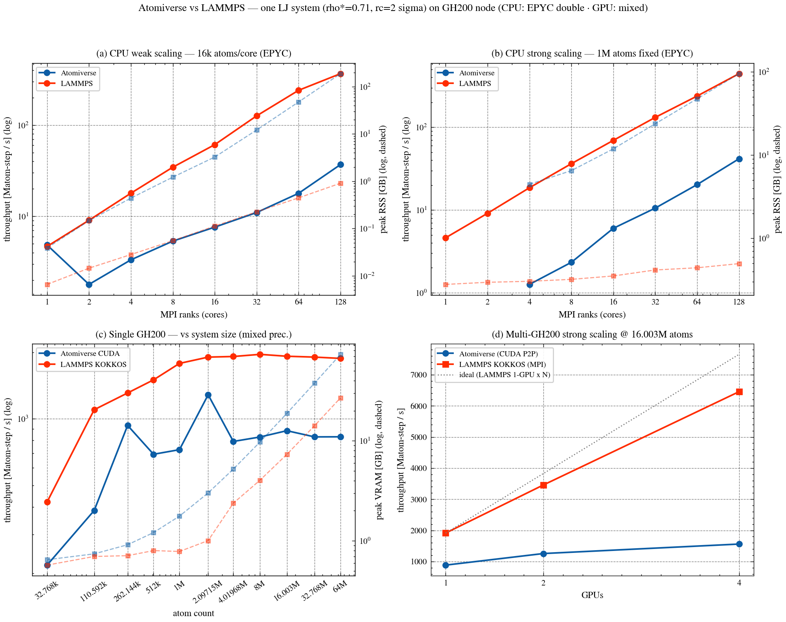

# System scaling benchmark — Atomiverse vs LAMMPS (2026-06-06)

A 2×2 scaling study of the Atomiverse MD engine against LAMMPS as a benchmark,
all on **one shared LJ system** so the CPU and GPU panels are directly
comparable.



## The system

Simple-cubic LJ fluid, identical parameters across every panel and both codes:

| quantity | value |
|----------|-------|
| σ        | 2.5 Å |
| ε        | 1.0 |
| lattice spacing | 1.12 σ → reduced density ρ\* = (1/1.12)³ ≈ 0.712 |
| cutoff   | 2 σ = 5.0 Å |
| steps    | 200 timed (+10 warmup) |

Built by `make_sc_lj_total` in `benchmarks/md/scaling.cpp` (CPU) and
`bench_multi_gpu_scaling.cu` (GPU) — same lattice, jitter and thermal
velocities, so the throughput numbers measure the same physics.

## Panels

- **(a) CPU weak scaling** — 16k atoms/core, 1→128 MPI ranks. Throughput (left,
  log) and peak RSS summed over ranks (right, log dashed).
- **(b) CPU strong scaling** — 1M atoms fixed, 1→128 ranks. Same axes.
- **(c) Single GH200** — throughput and peak VRAM vs system size (32k→64M
  atoms), mixed precision.
- **(d) Multi-GH200 strong scaling** — at the Pareto-optimal single-GPU size
  (16M atoms), 1/2/4 GPUs; AV uses single-process CUDA P2P over NVLink, LAMMPS
  uses KOKKOS/CUDA + MPI (`-pk kokkos gpu/aware on`).

## Hardware / precision

- **CPU:** AMD EPYC 9005 (`cpu` partition), MPICH 4.3.2, `FI_PROVIDER=shm`,
  `OMP_NUM_THREADS=1`, **double precision**.
- **GPU:** single NVIDIA GH200 node (up to 4 GPUs, NVLink). AV CUDA and LAMMPS
  KOKKOS/CUDA both **mixed precision**.

## Honest reading of the result

- LAMMPS leads on every panel. On CPU it is ~10× the per-core throughput; on a
  single GH200 it is ~2× AV's throughput; it also scales more steeply across
  multiple GPUs.
- **AV's biggest CPU gap is memory, not just speed:** the per-rank frame is
  replicated, so weak-scaling peak RSS explodes to ~188 GB at 128 ranks vs
  LAMMPS's <1 GB (visible on the log dashed axis). This is the dominant
  open scalability issue for the CPU engine.
- AV CPU multi-rank uses a **`HaloSend{cutoff, every=1}` workaround** (full
  halo rebuild every step) — the position-only halo refresh path desyncs the
  ranks on a bondless run. This costs the per-step count exchange and shows up
  as the weak-scaling dip at n=2 (single rank pays no halo cost). See
  `scaling.cpp` and the project note `atomiverse-cpu-mpi-desync-hang`.
- CPU strong-scaling AV points start at n=4: the n=1/2 single/dual-core 1M-atom
  runs are ~10–16× slower than LAMMPS and exceed the benchmark time budget;
  they add nothing to the (clear, log-log linear) trend.

## Reproduce the figure

```bash
# from this directory, with a Python that has matplotlib + scienceplots
python plot_2x2.py     # reads the *.csv here, writes sysbench_2x2.{png,pdf}
```

## Data files

| file | contents |
|------|----------|
| `cpu_scaling.csv` | CPU weak+strong, AV+LAMMPS: cores, atoms, wall_s, Matom-step/s, peak RSS |
| `av_single.csv` / `lmp_single.csv` | single-GPU sweep vs atom count |
| `av_multi.csv` / `lmp_multi.csv` | multi-GPU (1/2/4) at several sizes |
| `plot_2x2.py` | the plotting script (co-located paths) |
